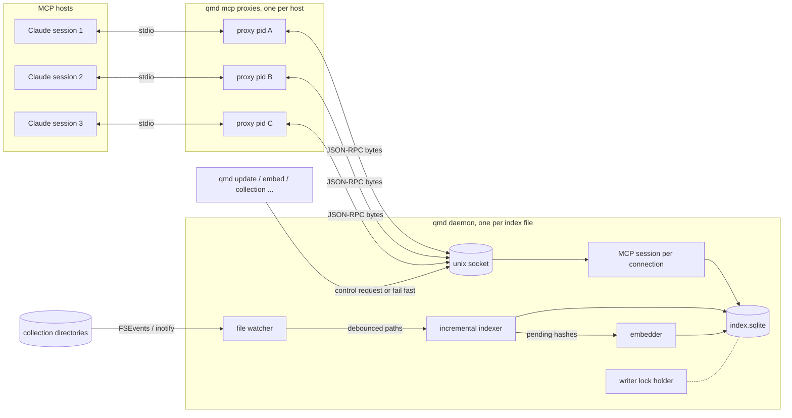
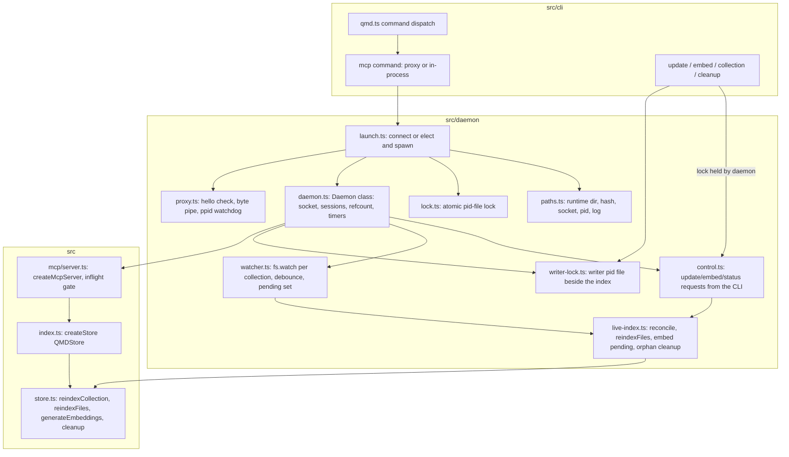
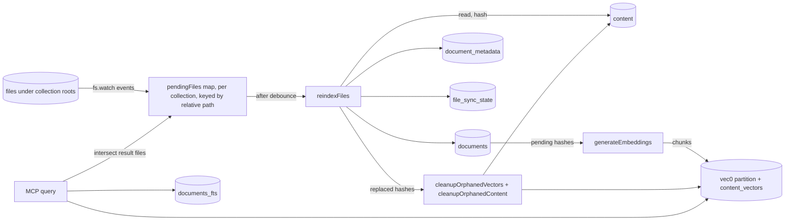
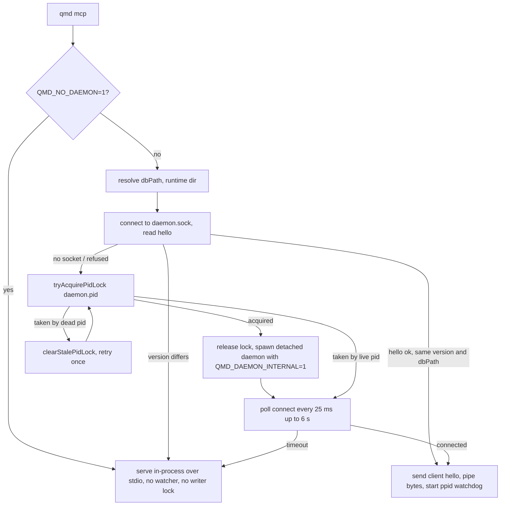
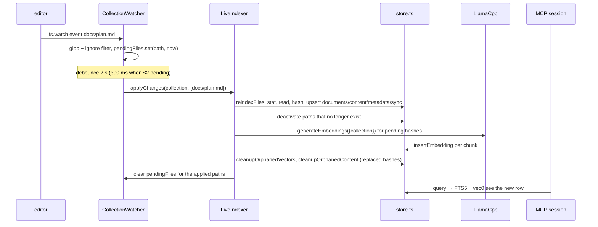
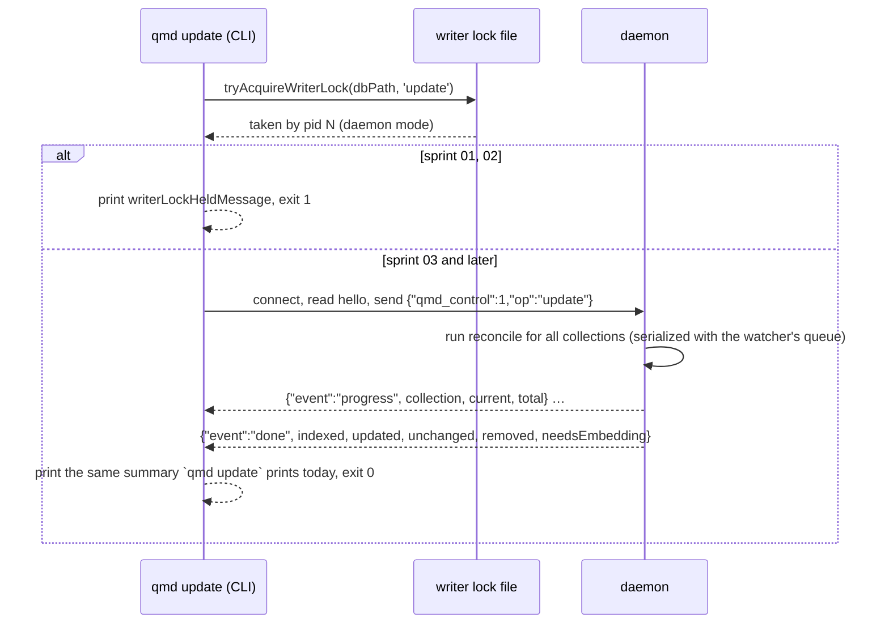

# Live Index Daemon

qmd keeps a search index over collections of files. Today the index goes stale between runs of `qmd update` and `qmd embed`, and every MCP client runs its own full server. This document is the design anchor for turning qmd into a live search engine: one detached daemon per index keeps the index current from native file events, and every `qmd mcp` client is a thin proxy to it. The pattern is ported from codegraph 1.6.x (`@colbymchenry/codegraph`, MIT), whose daemon, proxy, writer lock and registry are read from its compiled source (`lib/dist/mcp/{daemon,proxy,writer-lock,daemon-manager,daemon-registry,daemon-paths,ppid-watchdog}.js` and `lib/dist/sync/watcher.js`, package 1.6.2 as installed on 2026-11-01).

The four sprint specs under `docs/specs/` cite this document through `anchors: [live-index-daemon]`. Decisions the design rests on are in `docs/decisions/`.

## Vocabulary

- **Index**: one SQLite file. The global index is `~/.cache/qmd/index.sqlite` (`getDefaultDbPath`, `src/store.ts:697`); a named index is `~/.cache/qmd/<name>.sqlite` (`--index`); a project index is `<project>/.qmd/index.sqlite` beside `.qmd/index.yml`, found by walking up from the working directory (`findLocalConfigPath`, `src/collections.ts`).
- **Collection**: a named root directory plus a glob pattern and ignore list, configured in the YAML beside the index and mirrored into the `store_collections` table (`syncConfigToDb`, `src/store.ts:1503`).
- **Document**: one file under a collection, stored as a row in `documents` pointing at a content row by hash (`content.hash`). Deleting a file soft-deletes its row (`active = 0`).
- **Chunk**: a ~900-token slice of a document body; its vector lives in the partitioned vec0 table keyed by `(hash, seq, collection_id)` and is tracked in `content_vectors`.
- **Daemon**: the one long-lived process that owns an index: it watches the collections, writes the index, and serves MCP sessions over a Unix socket.
- **Proxy**: the short `qmd mcp` process an MCP host spawns; it pipes bytes between the host's stdio and the daemon's socket.
- **Writer lock**: the pid file that says which process may write an index.

## How qmd Works Today

### Index and collections

`qmd collection add <path> --name <n>` writes the collection into `~/.config/qmd/index.yml` and scans it. `qmd update` (`updateCollections`, `src/cli/qmd.ts:921`) runs each collection's optional `update:` hook, then `reindexCollection` (`src/store.ts:1844`) for every collection. The scan globs the root with fast-glob, drops hidden paths, and for each file:

1. stats it; a row in `file_sync_state` with the same `mtime_ms` and `size` and current metadata means "unchanged" with no read (the fast path added in #962);
2. otherwise reads it, hashes the content, and inserts or updates `content`, `documents`, `document_metadata` and `file_sync_state`;
3. after the loop, deactivates every active document whose path was not seen, deletes orphaned content rows, and the SDK's `update()` also copies vectors into collections that gained an embedded hash and removes vector rows no active document references.

Writes are grouped into short transactions by `scanWriteBatch` (500 files or 250 ms). A full pass over an unchanged collection is seconds; the first pass reads everything.

### Embedding

`qmd embed` (`vectorIndex`, `src/cli/qmd.ts:2395`) takes the embed lock (`src/cli/embed-lock.ts`, a pid file `.qmd-embed.lock` beside the index, with pid-identity checks from `src/cli/mcp-pid.ts`), then `generateEmbeddings` (`src/store.ts:2333`) selects every active hash that has fewer vectors than its expected chunk count for the configured model and fingerprint (`getPendingEmbeddingDocs`, `src/store.ts:2243`), chunks each document (`chunkDocumentByTokens`; AST-aware for code when `chunkStrategy` is `auto`), embeds with node-llama-cpp (embeddinggemma by default), and inserts the vectors. Embedding only touches pending hashes, so a second run after a small edit embeds only the edited documents. Models load lazily and the per-store `LlamaCpp` unloads them after 5 minutes idle (`src/index.ts`, `inactivityTimeoutMs`).

### Search

`qmd search` is BM25 over FTS5. `qmd query` expands the query with a small generator model into lex, vec and hyde sub-queries, runs each (FTS5 for lex, sqlite-vec for vec and hyde), fuses with reciprocal rank fusion, and reranks the top candidates with qwen3-reranker (`hybridQuery`, `src/store.ts:6264`). The MCP `query` tool and the HTTP `POST /query` route call the same SDK `store.search`.

### MCP server

`qmd mcp` (`src/mcp/server.ts`) opens the index, builds one `McpServer` per connection through `serveStdio` from `@modelcontextprotocol/server` 2.0.0, registers the `query`, `get`, `multi_get`, `status` and `metadata` tools and the `qmd://{path}` resource, and shuts down on stdin EOF (#751). Every MCP host spawns its own `qmd mcp`: the `bin/qmd` launcher process plus the server process, each opening the index and each able to load the three models. `qmd mcp --http [--daemon]` is a separate TCP server with a pid file in `~/.cache/qmd/mcp.pid`; nothing connects the stdio servers to it.

### Concurrency today

SQLite is opened in WAL mode with `busy_timeout` 120 s (`openDatabase`, `src/db.ts`), so concurrent processes queue on writes instead of failing. Nothing stops two `qmd update` runs, or an `update` and an MCP server, from both writing; only `embed` has a lock. Nothing watches files.

### Measured on this machine (2026-11-02, before any change)

Twenty-eight stock `qmd mcp` servers from Claude Code sessions were alive, each with its launcher process; 56 processes, 3,412 MB RSS in total, each server holding the 787 MB global index open. Raw capture: `docs/history/measurement-2026-11-02-live-daemon/baseline-stock-processes.txt`.

## Target



One daemon per index file. Each proxy is a byte pipe. All sessions share one open database, one watcher, and one set of loaded models.

## Mapping codegraph's Patterns onto qmd

| codegraph pattern | codegraph implementation (1.6.2) | qmd implementation |
|---|---|---|
| Daemon unit | one per project root, keyed by `canonicalProjectRoot` | one per index file, keyed by `sha256(realpath(dbPath))[0:16]`; decision `docs/decisions/2026-11-02-01-daemon-unit.md` |
| Rendezvous files | `.codegraph/daemon.pid`, `.codegraph/daemon.sock`, tmpdir fallback, `~/.codegraph/daemons/<hash>.json` registry | runtime dir `~/.cache/qmd/run/<hash>/` holding `daemon.pid` (JSON record), `daemon.sock`, `daemon.log`, `index.json` (the db path, for listing); the dir is outside every project and Dropbox tree and short enough for `sun_path` |
| Daemon election | pid file created by hard link of a complete temp record (`tryAcquireDaemonLock`), O_EXCL fallback, compare-and-delete of stale locks | same algorithm in `src/daemon/lock.ts`, shared by the daemon lock and the writer lock |
| Writer lock | `.codegraph/writer.pid`, held by whichever process owns the watcher; CLI `index` takes `rebuild.pid` | `.qmd-writer.lock` beside the index, generalized from `embed-lock.ts`; held by the daemon for its life, by `qmd update`, `qmd embed`, `qmd collection add/remove/rename`, `qmd cleanup` for their run |
| Version hello | daemon writes `{codegraph, pid, socketPath, protocol}` line first; proxy requires exact version | daemon writes `{qmd, pid, dbPath, protocol: 1}`; proxy requires exact `qmd` version and the same db path; mismatch falls back to in-process serving |
| Client hello | proxy sends `{codegraph_client: 1, pid, hostPid}` | proxy sends `{qmd_client: 1, pid, hostPid}`; the daemon reads one optional line, unshifts the rest |
| Transport | custom `SocketTransport` and `MCPSession` | the SDK's `StdioServerTransport(socket, socket)` passed to `serveStdio({ transport })`, one `McpServer` per connection, as the SDK documents; decision `2026-11-02-02-daemon-transport.md` |
| Refcount and idle exit | `clients` set, 300 s idle timer armed at zero clients, 30 min inactivity backstop reaping only when no client is provably alive, 30 s dead-peer sweep by pid | identical constants: `QMD_DAEMON_IDLE_MS` 300000, `QMD_DAEMON_MAX_IDLE_MS` 1800000, `QMD_DAEMON_SWEEP_MS` 30000 |
| Parent watchdog | proxy polls `process.ppid` against a baseline captured at the CLI entry | `qmd mcp` proxy records `process.ppid` at entry (`src/cli/qmd.ts` top) and polls every `QMD_PPID_POLL_MS` (5000); divergence closes the socket and exits |
| Detached spawn | `spawn(execPath, [cli, 'serve','--mcp'], {detached, stdio: ['ignore', log, log]})`, internal env var marks the daemon | `spawn(process.execPath, [cliEntry, ...indexArgs, 'mcp'], {detached: true, stdio: ['ignore', logFd, logFd], env: {QMD_DAEMON_INTERNAL: '1', INDEX_PATH}})`, same shape as the existing `--http --daemon` spawn (`src/cli/qmd.ts:5105`) |
| File watching | `fs.watch` recursive on macOS/Windows, per-directory inotify on Linux, no dependency | the same; one watcher per collection root; Node 24 supports recursive on Linux too, the per-directory walk stays as the fallback for `ERR_FEATURE_UNAVAILABLE_ON_PLATFORM`; decision `2026-11-02-03-file-watcher.md` |
| Debounce | 2 s, 300 ms quick path for ≤2 files, full scan above 500 pending | same constants: `QMD_WATCH_DEBOUNCE_MS` 2000, quick 300 ms, full-collection reindex above 500 pending or on a directory event |
| Incremental re-index | scoped sync of the pending paths | `reindexFiles(store, collection, relativePaths)` in `src/store.ts`, the per-file body of `reindexCollectionIn` factored out; deletions deactivate the document and drop its sync row |
| Connect-time reconcile | engine catch-up sync on daemon start | daemon start runs `reindexCollection` for every collection (fast path, seconds) then embeds pending hashes |
| Staleness | `pendingFiles` map intersected with tool results | the daemon keeps `pendingFiles` per collection; MCP `query` results flag a hit whose file is pending and prepend one line naming how many files are still being indexed; `status` reports watcher state |
| Env opt-out | `CODEGRAPH_NO_DAEMON=1` serves in-process | `QMD_NO_DAEMON=1` serves in-process exactly as today; `QMD_NO_WATCH=1` runs the daemon without a watcher |
| Discovery and stop | `codegraph daemon` picker, `stop --all` | `qmd status` lists the daemon for the active index (pid, clients, pending); `qmd mcp stop` stops it, falling back to the HTTP daemon pid file it stops today; no new verbs |

What is not ported: codegraph's local-handshake proxy (answering `initialize` and `tools/list` from static constants before the daemon is up). qmd's daemon binds its socket before opening the index, and the SDK pins one era per connection, so the proxy stays a pure byte pipe and the host waits at most the spawn time (~1 s measured in sprint 02).

## Components and Boundaries



Dependencies point inward: `src/daemon/*` depends on `src/mcp/server.ts`, `src/store.ts` and `src/index.ts`; nothing in `src/store.ts` or `src/mcp/server.ts` imports from `src/daemon/`. The CLI depends on both.

| Module | Owns | Depends on |
|---|---|---|
| `src/daemon/paths.ts` | runtime dir for a db path, socket and pid and log paths, lock record encode/decode | node:crypto, node:os, node:fs |
| `src/daemon/lock.ts` | `tryAcquirePidLock(path, record)`, `clearStalePidLock`, `isProcessAlive` (EPERM is alive) | node:fs |
| `src/daemon/writer-lock.ts` | `writerLockPathForDb`, `tryAcquireWriterLock(dbPath, mode)`, `readWriterLock`, `writerLockHeldMessage` | lock.ts, cli/mcp-pid.ts (pid identity) |
| `src/daemon/daemon.ts` | `Daemon` class: bind, hello, sessions, refcount, idle and backstop and sweep timers, graceful stop | paths, lock, writer-lock, mcp/server, index.ts, watcher, live-index, control |
| `src/daemon/proxy.ts` | `runProxy(socketPath, expected)`: hello check, client hello, pipe, ppid watchdog | paths |
| `src/daemon/launch.ts` | `startMcpStdio(dbPath)`: connect, else elect and spawn, else in-process | daemon, proxy, lock, paths |
| `src/daemon/watcher.ts` | `CollectionWatcher`: one `fs.watch` per collection root, glob and ignore filter, debounce, `pendingFiles` | node:fs, picomatch |
| `src/daemon/live-index.ts` | `LiveIndexer`: reconcile all, `applyChanges(collection, paths)`, embed pending, orphan cleanup, serialization of writes | store.ts, index.ts |
| `src/daemon/control.ts` | control line protocol: `{qmd_control: 1, op: 'update' \| 'embed' \| 'status'}` → JSON-lines progress and result | live-index |

## APIs and Interfaces

| Surface | Signature | In | Out | Errors | Caller |
|---|---|---|---|---|---|
| `qmd mcp` (stdio) | unchanged command | host stdio | MCP JSON-RPC | none new; falls back in-process | MCP hosts |
| `qmd mcp stop` | unchanged verb | active index | "Stopped daemon (pid N)" or HTTP pid-file path as today | exit 0 | user |
| `qmd status` | unchanged verb | active index | adds `Daemon: running (pid N, M clients, K pending)` or `Daemon: not running` | | user |
| `qmd update`, `qmd embed`, `qmd collection add/remove/rename`, `qmd cleanup` | unchanged verbs | | sprint 01: exit 1 with `writerLockHeldMessage` when the lock is held by a live process; sprint 03: `update` and `embed` delegate to the daemon and print its summary | exit 1 | user |
| `qmd init` | unchanged verb | project dir | sprint 04: writes `docs` and `code` collections and `.qmd/.gitignore` | | user |
| Daemon hello | first line on connect: `{"qmd":"2.8.3","pid":123,"dbPath":"/…/index.sqlite","protocol":1}` | | | proxy falls back on mismatch | proxy |
| Client hello | optional first line from client: `{"qmd_client":1,"pid":456,"hostPid":789}` | | | ignored if absent or malformed | daemon |
| Control request | first line `{"qmd_control":1,"op":"update"\|"embed"\|"status","collections?":[]}` | | JSON lines `{"event":"progress",…}` then `{"event":"done",…}` or `{"event":"error","message"}` | | CLI |
| MCP `query` tool | unchanged schema | | each result gains `stale?: true`; the text summary gains a leading line when files are pending | | hosts |
| MCP `status` tool | unchanged schema | | gains `daemon: {pid, clients, watching: [{collection, pending}], lastReconcileAt}` | | hosts |
| `reindexFiles(store, collectionPath, collectionName, relativePaths, opts)` | new in `src/store.ts` | | `ReindexResult` | throws on SQLite error | live-index |
| `startMcpServer(options)` | gains `{ transport?: Transport }` | | | | daemon |
| Environment | `QMD_NO_DAEMON`, `QMD_NO_WATCH`, `QMD_DAEMON_IDLE_MS`, `QMD_DAEMON_MAX_IDLE_MS`, `QMD_DAEMON_SWEEP_MS`, `QMD_WATCH_DEBOUNCE_MS`, `QMD_PPID_POLL_MS`, `QMD_DAEMON_INTERNAL` (set by the launcher only) | runtime plane, owner `src/daemon` | | | |

## Dataflow



Writer of every store is the daemon while it runs; the CLI writes only when it holds the writer lock. Readers: MCP sessions in the daemon and read-only CLI commands in other processes, through SQLite WAL.

## Workflows

### `qmd mcp` start



The daemon-elect releases the election lock before spawning because the spawned daemon acquires it in its own name; the window is closed by the daemon's own atomic acquire, and a second launcher that wins in between simply spawns the daemon the first one would have.

### Daemon lifecycle

```mermaid
stateDiagram-v2
  [*] --> Electing: QMD_DAEMON_INTERNAL=1
  Electing --> Exiting: daemon.pid held by live daemon
  Electing --> Binding: acquired daemon.pid
  Binding --> Exiting: writer lock held by live process
  Binding --> Serving: socket bound, writer lock held, index opened
  Serving --> Reconciling: start: reindexCollection for every collection, embed pending
  Reconciling --> Serving
  Serving --> Serving: connection: hello, session; close: drop client
  Serving --> Idle: last client gone, idle timer 300 s armed
  Idle --> Serving: new connection
  Idle --> Exiting: timer fires with zero clients
  Serving --> Exiting: 30 min without inbound bytes and no client provably alive
  Serving --> Exiting: SIGTERM or SIGINT
  Exiting --> [*]: close sessions, stop watcher, close store, release writer lock, remove pid, sock, registry record
```



### A file save becomes searchable



Between the event and the end of `reindexFiles` the file is pending: a `query` result for it carries `stale: true` and the summary says one file is still being indexed. Between `reindexFiles` and the end of embedding the file is found by BM25 but not by vector search; `status` reports `needsEmbedding`.

### `qmd update` while the daemon runs



## Algorithms

### Election and lock files

Objective: at most one daemon per index file, and at most one writer per index file, with no empty-file window and no deletion of a live holder's lock.

```text
tryAcquirePidLock(pidPath, record):
  mkdir -p dirname(pidPath)
  tmp = pidPath + "." + pid + ".tmp"
  write(tmp, JSON(record) + "\n", mode 0600)
  try link(tmp, pidPath): acquired                  # atomic and exclusive
  catch EEXIST: taken
  catch other: acquired = openExclusive(pidPath) and write record   # filesystems without link()
  finally unlink(tmp)
  if acquired: return {kind: acquired}
  existing = decode(read(pidPath))                  # complete record or null
  return {kind: taken, existing}

acquireOrClear(pidPath, record):
  r = tryAcquirePidLock(pidPath, record)
  if r.taken and (r.existing == null or not isProcessAlive(r.existing.pid)):
    clearStalePidLock(pidPath, expectedDeadPid = r.existing?.pid)   # re-reads, compare-and-delete
    r = tryAcquirePidLock(pidPath, record)
  return r

isProcessAlive(pid): kill(pid, 0) succeeds, or fails with EPERM
```

Worked example: two launchers start at once with no daemon. Both call `tryAcquirePidLock`; one `link()` succeeds, the other gets EEXIST and reads the winner's complete record, then polls the socket. The winner spawns the daemon, which acquires `daemon.pid` in its own name (the launcher released it first), binds, and both launchers connect.

### Proxy

```text
runProxy(socketPath):
  if not exists(socketPath): return fallback
  socket = connect(socketPath)
  hello = readLine(socket, timeout 3 s, max 4096 bytes)     # JSON {qmd, pid, dbPath, protocol}
  if hello.qmd != ourVersion or hello.dbPath != ourDbPath: return fallback
  socket.write(JSON({qmd_client: 1, pid, hostPid: EARLY_PPID}) + "\n")
  stdin.on data → socket.write; stdin.on end → socket.end
  socket.on data → stdout.write; socket.on end/close/error → exit 0
  every QMD_PPID_POLL_MS: if process.ppid != EARLY_PPID: socket.destroy(); exit 0
```

### Daemon connection handling

```text
onConnection(socket):
  socket.write(JSON(hello) + "\n")
  peers = readClientHello(socket)         # optional; unshifts non-hello bytes; 3 s timeout
  transport = new StdioServerTransport(socket, socket)
  handle = serveStdio(() => createMcpServer(store, inflight), { transport })
  clients.add({handle, peers}); disarmIdleTimer()
  socket.on close → clients.delete; if clients.size == 0: armIdleTimer()
  socket.on data → lastActivityAt = now
```

### Refcount, idle exit, backstop, sweep

```text
armIdleTimer(): if idleMs > 0 and no timer: setTimeout(idleMs, () => if clients.size == 0: stop('idle'))
every min(maxIdleMs, 60 s): if clients.size > 0 and now - lastActivityAt >= maxIdleMs:
    reapDeadClients(); if clients.size > 0 and none has a live peer pid: stop('inactivity backstop')
every sweepMs: reapDeadClients()          # drop a client whose pid or hostPid is dead
reapDeadClients(): for c in clients: if c.peers.pid and (!alive(c.peers.pid) or (c.peers.hostPid and !alive(c.peers.hostPid))): c.handle.close(); drop(c)
```

Tunables: `QMD_DAEMON_IDLE_MS` 300000 (0 never), `QMD_DAEMON_MAX_IDLE_MS` 1800000 (0 off), `QMD_DAEMON_SWEEP_MS` 30000 (0 off).

### Watcher and debounce

```text
CollectionWatcher.start(collection):
  root = realpath(collection.path)
  matcher = picomatch(splitGlobMask(collection.pattern)); ignore = picomatch([defaults..., collection.ignore...])
  try watcher = fs.watch(root, {recursive: true}, onEvent)
  catch ERR_FEATURE_UNAVAILABLE_ON_PLATFORM: watch each non-ignored directory, add new ones on events, cap 50_000
  catch EMFILE/ENFILE: degrade('watch limit'); report through status

onEvent(eventType, relPath):
  if relPath null or any segment starts with "." or ignore(relPath): return
  if relPath is a directory, or stat fails and relPath is not a known document: needsFullScan = true
  else if matcher(relPath): pendingFiles.set(relPath, now)
  schedule()

schedule():
  quiet = pendingFiles.size <= 2 ? 300 ms : debounceMs
  reset timer to quiet → flush()

flush():
  paths = [...pendingFiles.keys()]; syncStartedMs = now
  if needsFullScan or paths.length > 500: indexer.reconcile(collection)   # reindexCollection, fast path
  else: indexer.applyChanges(collection, paths)
  on success: delete entries whose lastSeen <= syncStartedMs; needsFullScan = false
  on failure: keep entries, backoff 1 s doubling to 30 s, degrade after 5 consecutive failures
```

Worked example: saving `docs/plan.md` once emits two events within 50 ms (write, attribute change); both land in `pendingFiles` as one key; the quick path fires 300 ms after the last; `applyChanges` reads one file.

### Incremental re-index

```text
reindexFiles(store, collectionPath, collectionName, relativePaths):
  batch = scanWriteBatch(db); syncState = getFileSyncStateMap(db, collectionName)
  for path in relativePaths:
    batch.next()
    abs = getRealPath(join(collectionPath, path))
    if not isPathInsideDir(collectionPath, abs): skip OUTSIDE_COLLECTION
    stat = statSync(abs) or null
    if stat == null or not stat.isFile():
      if findActiveDocument(db, collectionName, path): deactivateDocument; deleteFileSyncState; removed++
      continue
    ... identical per-file body to reindexCollectionIn (size cap, fast path, read, empty → retire, hash,
        hash-match → update sync row + metadata backfill, else insert/update content, document, sync row, metadata)
  batch.commit()
  orphanedCleaned = cleanupOrphanedContent(db)
  return ReindexResult
```

`reindexCollectionIn` is rewritten as: glob → `reindexFiles` over the globbed list → deactivate unseen paths, so the two share one per-file body (S3: one owner for the per-file logic).

### LiveIndexer serialization

```text
LiveIndexer.run(task):                   # one writer queue for the whole daemon
  queue = queue.then(() => task()).catch(log)
  return queue

reconcileAll(): for col in getStoreCollections(db): run(() => reindexCollection(...)); run(() => embedPending()); run(() => cleanup())
applyChanges(col, paths): run(() => reindexFiles(...)); run(() => embedPending(col)); run(() => cleanupIfReplaced())
embedPending(col?): generateEmbeddings(store, {collection: col, chunkStrategy: 'auto', maxDurationMs: 10 min})
cleanup(): copyVectorsToNewCollections(db); cleanupOrphanedVectors(db); cleanupOrphanedContent(db)
```

Embedding runs on the daemon's event loop through node-llama-cpp's async API, so sessions keep answering during a long embed; search quality during that window is BM25-only for the new content.

### Control requests

```text
readFirstLine(socket) parses one of: daemon hello reply expected by proxy (outbound), client hello, control request.
control update: result = await indexer.reconcileAll(progress → write {"event":"progress",...}); write {"event":"done", ...UpdateResult}; socket.end()
control embed:  result = await indexer.embedPending(collection, progress); write done
control status: write {"event":"done", pid, clients, watching: [{collection, pending, degraded}], lastReconcileAt, needsEmbedding}
```

## State and Data Lifecycle

| Store | Writer | Authority | Readers | Retention | Recovery |
|---|---|---|---|---|---|
| `index.sqlite` tables | daemon (or a CLI holding the writer lock) | derived from the files; the files are authoritative | daemon sessions, CLI reads | until the collection is removed or `qmd cleanup` | re-derivable by `qmd update && qmd embed` |
| `<dir>/.qmd-writer.lock` | the process that holds it | the live pid in it | every writer, `qmd status` | life of the holder; stale ones are compare-and-deleted | pid identity check (`isQmdMcpPid`) |
| `~/.cache/qmd/run/<hash>/daemon.pid` | daemon-elect, refreshed by the daemon | the live pid and socket in it | launchers, `qmd status`, `qmd mcp stop` | life of the daemon | stale ones cleared after a failed hello probe |
| `~/.cache/qmd/run/<hash>/daemon.sock` | daemon | | proxies, CLI control | life of the daemon | unlinked by the next daemon-elect before bind |
| `~/.cache/qmd/run/<hash>/daemon.log` | daemon stderr | | humans | appended, truncated at 5 MB on start | |
| `~/.cache/qmd/run/<hash>/index.json` | daemon | `{dbPath, configPath, startedAt}` for listing | `qmd status`, `qmd mcp stop` | life of the daemon | pruned when its pid is dead |
| `pendingFiles` (memory) | watcher | | sessions (staleness), control status | until applied | lost on restart; the start-up reconcile covers it |

A project index under Dropbox keeps its `.qmd/` directory out of sync (`xattr -w com.dropbox.ignored 1 .qmd`); the runtime dir is never under a project.

## Failure and Recovery

| Failure | Behaviour |
|---|---|
| Daemon version differs from the proxy (after an upgrade) | proxy serves in-process for this session and logs one line; the stale daemon exits on idle; `qmd mcp stop` ends it sooner |
| Socket exists but nobody listens | connect fails ECONNREFUSED → election path; the elect unlinks the socket before bind |
| `daemon.pid` names a dead pid | cleared by compare-and-delete, retried once |
| `daemon.pid` names a live unrelated pid (pid reuse) | hello probe fails → lock cleared with `allowLivePid` only after the failed hello; otherwise left alone and the proxy serves in-process |
| Writer lock held by a live `qmd update` when the daemon starts | daemon exits with the message; launchers fall back in-process; the next `qmd mcp` after the update finishes starts the daemon |
| Host killed with SIGKILL | proxy ppid watchdog exits within 5 s → socket close → refcount drops; if the close is never delivered, the sweep drops the client by pid |
| Daemon killed with SIGKILL | sockets close → proxies exit → hosts restart `qmd mcp` → a new daemon is elected; stale pid and socket are cleared |
| Watch limit (EMFILE, ENOSPC) | watcher degrades for that collection; `status` reports it; reconcile still runs on each control `update` |
| Embedding fails (model missing, OOM) | `generateEmbeddings` records failures; the hashes stay pending and are retried on the next cycle, at most once per 10 minutes |
| SQLite busy from an external writer | `busy_timeout` 120 s; the writer lock makes this rare |

Observability: the daemon log carries one line per lifecycle event (bind, client attach and detach with pids, reconcile summary with counts and ms, each applyChanges with counts and ms, embed summary, idle exit reason). `status` exposes the same counters live.

## Security

The socket and pid files are mode 0600 in the user's cache dir; no network listener is added. The daemon runs collection `update:` hooks only through the control `update` path and only when the project config is trusted, exactly as `qmd update` does today (`resolveLocalConfigTrust`). The client hello and control line are bounded to 4096 bytes and parsed with a strict shape check; anything else is treated as JSON-RPC and handed to the SDK, which validates it.

## Change Map

| Path | Change | Sprint |
|---|---|---|
| `src/daemon/lock.ts` | new: atomic pid-file lock, stale clearing, liveness | 01 |
| `src/daemon/writer-lock.ts` | new: writer lock beside the index, generalizing `embed-lock.ts` | 01 |
| `src/cli/embed-lock.ts` | deleted; `embed` uses the writer lock | 01 |
| `src/cli/qmd.ts` | `update`, `embed`, `collection add/remove/rename`, `cleanup` take the writer lock; `status` shows the holder | 01, 02, 03 |
| `test/embed-lock.test.ts` → `test/writer-lock.test.ts` | lock semantics, cross-process holder, messages | 01 |
| `src/daemon/paths.ts` | new: runtime dir, hashes, record codec | 02 |
| `src/daemon/daemon.ts`, `proxy.ts`, `launch.ts` | new | 02 |
| `src/mcp/server.ts` | `startMcpServer` accepts a transport; `createMcpServer` exported for the daemon | 02 |
| `src/cli/qmd.ts` | `mcp` dispatch: `QMD_DAEMON_INTERNAL` → daemon, else launch; `mcp stop` stops the socket daemon; early ppid capture | 02 |
| `test/daemon-*.test.ts` | lock election, hello and version check, refcount and idle, ppid watchdog, dead-peer sweep, end-to-end two proxies one daemon | 02 |
| `src/daemon/watcher.ts`, `live-index.ts`, `control.ts` | new | 03 |
| `src/store.ts` | `reindexFiles` factored out of `reindexCollectionIn` | 03 |
| `src/mcp/server.ts` | `stale` flag and pending line in `query`; daemon block in `status` | 03 |
| `src/cli/qmd.ts` | `update` and `embed` delegate when the daemon holds the lock | 03 |
| `test/live-index.test.ts`, `test/watcher.test.ts` | incremental paths, deletions, debounce, reconcile, staleness, delegation | 03 |
| `src/cli/qmd.ts` | `init` writes `docs` and `code` collections and `.qmd/.gitignore` | 04 |
| `src/daemon/live-index.ts` | orphan cleanup after replaced hashes | 04 |
| `README.md`, `skills/qmd/SKILL.md`, `skills/qmd/references/mcp-setup.md`, `CHANGELOG.md` | daemon behaviour, env vars, `qmd init` | 02, 03, 04 |

## Verification

- Unit: lock election races (two processes), stale clearing, hello parsing, refcount timers with injected clocks, watcher filtering and debounce with an injected `fs.watch`, `reindexFiles` on create, modify, delete, rename, empty, oversize.
- Integration: spawn two `qmd mcp` proxies against one temp index; assert one daemon pid, two clients in `status`, tool calls answered through both, daemon exits `QMD_DAEMON_IDLE_MS` after both close; kill a proxy's parent and assert the sweep drops it.
- End to end: write a file under a watched collection, poll the MCP `query` tool until the file is found, record the latency; the same for a deletion.
- Commands: `bun run test:types`, `bun run test:unit` (vitest under Node and bun test), `bun run lint`.
- Measurement record: `docs/history/measurement-2026-11-02-live-daemon/`.

## Decisions

- `docs/decisions/2026-11-02-01-daemon-unit.md`: one daemon per index file, runtime dir under the cache.
- `docs/decisions/2026-11-02-02-daemon-transport.md`: SDK stdio transport over a Unix socket; proxy is a byte pipe.
- `docs/decisions/2026-11-02-03-file-watcher.md`: Node `fs.watch`, no new dependency.
- `docs/decisions/2026-11-02-04-writer-lock.md`: generalize the embed lock; fail fast first, delegate later.
- `docs/decisions/2026-11-02-05-pr-split.md`: four stacked branches, docs excluded from upstream PRs.
