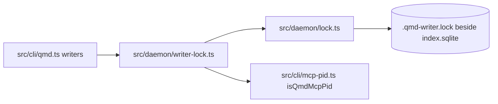
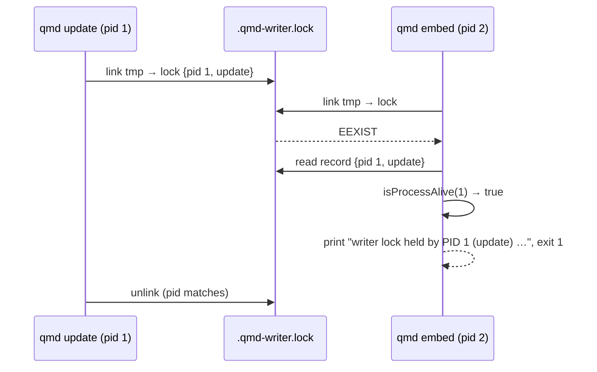

# Requirements: Writer Lock

## Scope

One lock per index file for every command that writes the index. Today only `qmd embed` is locked; `qmd update`, `qmd collection add/remove/rename` and `qmd cleanup` can run concurrently with each other and with an embed. This sprint generalizes `src/cli/embed-lock.ts` into `src/daemon/writer-lock.ts` and makes every writer take it. Design: `docs/design/live-index-daemon.md`, sections "Election and lock files" and "Writer lock".

## Glossary

- **Writer**: a process that changes `documents`, `content`, `content_vectors`, the vec0 partition, `file_sync_state` or `store_collections`.
- **Holder record**: the JSON line in the lock file: `{"pid": number, "mode": string, "startedAt": number}`.

## Mental Model And Invariants

- Model: an index file has at most one writer at a time; a second writer learns who holds the lock and why.
- Invariant: a lock file is created with its complete record in one atomic step (hard link of a temp file, or O_EXCL open where links are unsupported).
- Invariant: a lock is removed only by its holder, or by a process that read a dead or non-qmd pid in it and re-reads it before unlinking.
- Invariant: read-only commands never take the lock.

## Decisions And Corrections

- 2026-11-02: lock location and fail-fast behaviour, `docs/decisions/2026-11-02-04-writer-lock.md`.

## Configuration

None new. The lock path is derived from the index path.

## Requirements

### R1. One lock module

WHEN any writer starts, THE CLI SHALL call `tryAcquireWriterLock(dbPath, mode)` from `src/daemon/writer-lock.ts` and release it on exit, including on `process.exit` paths it already has.

### R2. Fail fast with the holder

WHEN the lock is held by a live qmd process, THE writer SHALL print `writerLockHeldMessage(record, lockPath)` naming the pid, mode and lock path, and exit 1. Embed keeps its current wording for the embed-on-embed case ("Another embed process is already running. Skipping.") so existing tests and scripts hold.

### R3. Stale recovery

WHEN the lock file names a pid that is dead or is not a qmd process, THE acquirer SHALL remove it and retry once, as `tryAcquireEmbedLock` does today.

### R4. Atomic creation

WHEN two writers race, THE lock SHALL be won by exactly one, and the loser SHALL read a complete record (never an empty file).

### R5. Status

WHEN `qmd status` runs and the lock is held, THE output SHALL show `Writer: <mode> (PID n)`.

## Non-Functional Requirements

- Acquire and release cost under 5 ms; no network.
- Works on filesystems without hard links (ExFAT) through the O_EXCL fallback.

## Out Of Scope

- Delegating a write to a running daemon (sprint 03).
- Locking `llm_cache` writes made by searches.

# Design

See `docs/design/live-index-daemon.md`: component table rows for `lock.ts` and `writer-lock.ts`, algorithm "Election and lock files", failure table rows for stale and reused pids.

## Components

## Interfaces

| Function | Signature | Behaviour |
|---|---|---|
| `tryAcquirePidLock` | `(pidPath: string, record: object) => {kind:'acquired'} \| {kind:'taken', existing: Record \| null}` | link-into-place, O_EXCL fallback |
| `clearStalePidLock` | `(pidPath, expectedDeadPid?: number) => boolean` | compare-and-delete; refuses a live pid |
| `isProcessAlive` | `(pid) => boolean` | `kill(pid, 0)`; EPERM counts as alive |
| `writerLockPathForDb` | `(dbPath) => string` | `<dir>/.qmd-writer.lock` |
| `tryAcquireWriterLock` | `(dbPath, mode: 'update' \| 'embed' \| 'collection' \| 'cleanup' \| 'daemon') => WriterLockHandle \| {held: Record \| null, lockPath}` | stale clear and one retry |
| `readWriterLock` | `(dbPath) => Record \| null` | for `status` |
| `writerLockHeldMessage` | `(record, lockPath) => string` | one sentence with pid, mode, path, and how to clear a stale file |

## Sequence

## Change Map

| Path | Change |
|---|---|
| `src/daemon/lock.ts` | new |
| `src/daemon/writer-lock.ts` | new; replaces `src/cli/embed-lock.ts` |
| `src/cli/embed-lock.ts` | deleted |
| `src/cli/qmd.ts` | `vectorIndex`, `updateCollections`, `indexFiles` callers (`collection add`), `collection remove/rename`, `cleanup`, `status` |
| `test/embed-lock.test.ts` | renamed `test/writer-lock.test.ts`, extended |
| `test/_helpers/embed-lock-holder.ts` | renamed `writer-lock-holder.ts` |
| `CHANGELOG.md` | Unreleased: Fixed |

## Verification

- `test/writer-lock.test.ts`: acquire, second acquire taken, release, stale pid cleared, non-qmd live pid cleared, cross-process holder (child process) blocks and then frees, message content, lock path.
- `test/cli.test.ts`: `qmd update` while a child holds the lock exits 1 with the message; `qmd status` shows the holder.
- `bun run test:types && bun run lint && bun run test:unit`.

# Tasks

## Tasks
- [x] 1. Foundation
  - [ ] 1.1 `src/daemon/lock.ts` with atomic acquire, stale clear, liveness
    - Requirements: R3, R4
    - Verification: `test/writer-lock.test.ts` lock cases
- [x] 2. Core
  - [ ] 2.1 `src/daemon/writer-lock.ts`; delete `embed-lock.ts`; `embed` uses it
    - Depends: 1.1
    - Requirements: R1, R2
    - Verification: `test/writer-lock.test.ts`, `test/cli.test.ts` embed cases pass unchanged
  - [ ] 2.2 `update`, `collection add/remove/rename`, `cleanup` take the lock and fail fast
    - Depends: 2.1
    - Requirements: R1, R2
    - Verification: `test/cli.test.ts` new cases
  - [ ] 2.3 `qmd status` shows the writer
    - Requirements: R5
- [x] 3. Tests
  - [ ] 3.1 Cross-process race: two children acquire at once, exactly one wins
    - Requirements: R4
- [x] 4. Polish And Docs
  - [ ] 4.1 CHANGELOG entry; README mention under `qmd update`

## Log
- 2026-11-02: spec written from `src/cli/embed-lock.ts`, `src/cli/qmd.ts` writer paths and codegraph `writer-lock.js`.
- 2026-11-02: shipped on branch `live/01-writer-lock`, one commit. Evidence: `test/writer-lock.test.ts` 15 tests and `test/cli.test.ts` 175 tests pass under vitest on Node 24.12.0; `test/cli.test.ts` + `test/writer-lock.test.ts` 190 pass under bun 1.3.6; `bun run test:types` and `bun run lint` clean. Deviation from the plan: the pid in the holder message is asserted for liveness, not equality, because tsx runs the test helper in a grandchild process. Task 2.2 covers `collection add/remove/rename` and `cleanup`; the dry-run cleanup path reads only and takes no lock.
