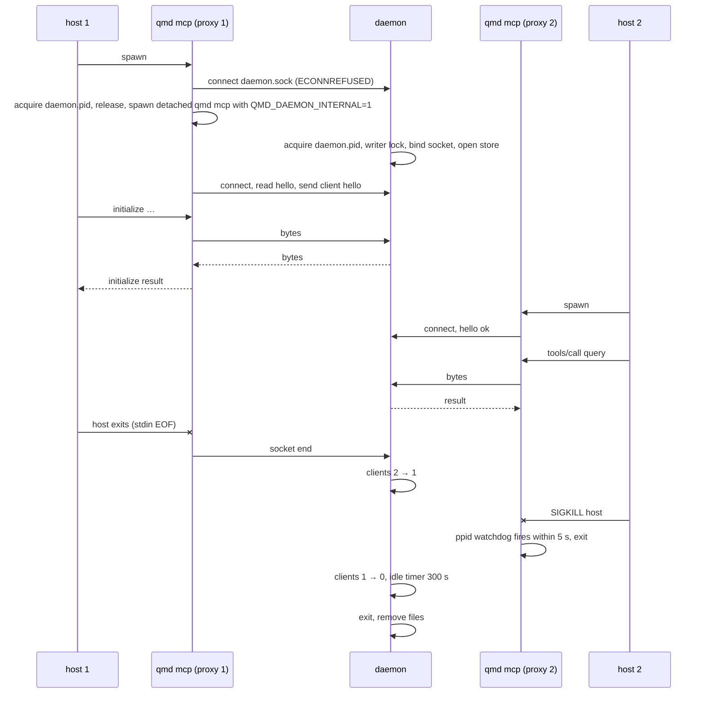

# Requirements: Daemon And Proxy

## Scope

`qmd mcp` connects to a running daemon for its index or elects one and spawns it detached; the host's stdio is piped to the daemon's Unix socket. One daemon per index file holds the index and the writer lock, serves every session, and exits 300 s after its last client leaves. Design: `docs/design/live-index-daemon.md`.

## Glossary

See the design's Vocabulary.

## Mental Model And Invariants

- Model: a Claude session's `qmd mcp` is a cable to the one daemon for that index; many cables, one daemon.
- Invariant: the proxy forwards bytes unchanged after the hello line; it never parses JSON-RPC.
- Invariant: a daemon serves only clients of its own qmd version and its own index path.
- Invariant: with `QMD_NO_DAEMON=1`, `qmd mcp` behaves exactly as in 2.8.3.
- Invariant: the daemon never outlives its last client by more than `QMD_DAEMON_IDLE_MS` plus one sweep, and never a phantom client by more than `QMD_DAEMON_MAX_IDLE_MS`.

## Decisions And Corrections

- 2026-11-02: `docs/decisions/2026-11-02-01-daemon-unit.md`, `2026-11-02-02-daemon-transport.md`.

## Configuration

| Key | Plane | Owner | Default |
|---|---|---|---|
| `QMD_NO_DAEMON` | runtime | `src/daemon/launch.ts` | unset |
| `QMD_DAEMON_IDLE_MS` | runtime | `src/daemon/daemon.ts` | 300000 |
| `QMD_DAEMON_MAX_IDLE_MS` | runtime | `src/daemon/daemon.ts` | 1800000 |
| `QMD_DAEMON_SWEEP_MS` | runtime | `src/daemon/daemon.ts` | 30000 |
| `QMD_PPID_POLL_MS` | runtime | `src/daemon/proxy.ts` | 5000 |
| `QMD_DAEMON_INTERNAL` | runtime, set by the launcher | `src/cli/qmd.ts` | unset |

## Requirements

### R1. Attach or elect

WHEN `qmd mcp` starts without `QMD_NO_DAEMON`, THE launcher SHALL connect to the daemon socket for the resolved index; if none answers, acquire the daemon lock, spawn the daemon detached, and connect within 6 s; otherwise serve in-process.

### R2. Version hello

WHEN the proxy connects, THE daemon SHALL send one JSON line `{qmd, pid, dbPath, protocol: 1}` first; THE proxy SHALL serve in-process when `qmd` or `dbPath` differs from its own.

### R3. Sessions

WHEN a connection completes the hello, THE daemon SHALL serve it with `serveStdio` over a `StdioServerTransport(socket, socket)` from the existing `createMcpServer` factory, so every tool and resource behaves as in 2.8.3.

### R4. Refcount and idle exit

WHEN the last client disconnects, THE daemon SHALL exit after `QMD_DAEMON_IDLE_MS` unless a client connects first; WHEN clients are connected but no inbound byte arrives for `QMD_DAEMON_MAX_IDLE_MS` and no client has a provably live peer pid, THE daemon SHALL exit; every `QMD_DAEMON_SWEEP_MS` THE daemon SHALL drop clients whose peer pid or host pid is dead.

### R5. Parent watchdog

WHEN the proxy's parent pid changes from the one captured at CLI entry, THE proxy SHALL close its socket and exit within `QMD_PPID_POLL_MS`.

### R6. Writer lock

WHEN the daemon starts, THE daemon SHALL take the writer lock in mode `daemon` and hold it until exit; WHEN the lock is held by another live process, THE daemon SHALL exit with that message and launchers SHALL serve in-process.

### R7. Stop and status

WHEN `qmd mcp stop` runs, THE CLI SHALL SIGTERM the daemon for the active index after a successful hello probe, wait up to 3 s, SIGKILL if needed, and clean its runtime files; it SHALL still stop the HTTP daemon pid file when no socket daemon exists. WHEN `qmd status` runs, THE output SHALL include the daemon's pid, client count and uptime, or "not running".

### R8. Shutdown

WHEN SIGTERM or SIGINT arrives, THE daemon SHALL close sessions, close the store (disposing models), release the writer lock, and remove its pid, socket and registry files.

## Non-Functional Requirements

- Cold start (no daemon) to first MCP reply under 2 s on this machine; warm attach under 100 ms.
- Three sessions use one daemon process plus three proxies; proxy RSS under 60 MB each.
- No stdout write from the proxy other than daemon bytes (MCP stdio contract).

## Out Of Scope

- File watching, staleness, control requests (sprint 03).
- A local-handshake proxy answering `initialize` before the daemon is up.

# Design

Anchored in `docs/design/live-index-daemon.md`: workflows "qmd mcp start" and "Daemon lifecycle", algorithms "Proxy", "Daemon connection handling", "Refcount, idle exit, backstop, sweep", the failure table, and the change map rows for sprint 02.

## Sequence: two hosts, one daemon

## Change Map

| Path | Change |
|---|---|
| `src/daemon/paths.ts` | new |
| `src/daemon/daemon.ts` | new, `Daemon` class |
| `src/daemon/proxy.ts` | new |
| `src/daemon/launch.ts` | new, `startMcpStdio(dbPath, configPath)` |
| `src/mcp/server.ts` | export `createMcpServer`; `startMcpServer({ transport? })` |
| `src/cli/qmd.ts` | capture `EARLY_PPID` at top; `mcp` dispatch to daemon or launcher; `mcp stop`; `status` |
| `test/daemon-lock.test.ts` | election races, stale clear, hello codec |
| `test/daemon-lifecycle.test.ts` | `Daemon` with injected clock and liveness: refcount, idle, backstop, sweep |
| `test/mcp-daemon.test.ts` | end to end: two proxies, one daemon pid, tool calls through both, idle exit, `QMD_NO_DAEMON` |
| `README.md`, `skills/qmd/references/mcp-setup.md`, `CHANGELOG.md` | daemon behaviour and env vars |

## Verification

- Unit: `test/daemon-lock.test.ts`, `test/daemon-lifecycle.test.ts` (timers injected, `QMD_DAEMON_IDLE_MS` small).
- End to end: `test/mcp-daemon.test.ts` spawns `qmd mcp` twice against a temp index with `XDG_CACHE_HOME` pointed at a temp dir, asserts `daemon.pid` holds one pid, both answer `tools/list`, and the daemon exits within idle ms after both stdin close; a third test kills a proxy's parent shell and asserts the client count drops.
- Commands: `bun run test:types && bun run lint && bun run test:unit`.

# Tasks

- [x] 1. Foundation
  - [x] 1.1 `paths.ts`: runtime dir, record codec, hello types
  - [x] 1.2 `server.ts`: export factory, accept transport
- [x] 2. Core
  - [x] 2.1 `daemon.ts`: bind, hello, sessions, refcount, timers, stop, writer lock
  - [x] 2.2 `proxy.ts`: hello check, client hello, pipe, ppid watchdog
  - [x] 2.3 `launch.ts`: connect → elect → spawn → poll → fallback; `QMD_NO_DAEMON`
  - [x] 2.4 CLI: dispatch, `mcp stop`, `status`, early ppid capture
- [x] 3. Tests
  - [x] 3.1 lock and codec units
  - [x] 3.2 lifecycle units with injected clock
  - [x] 3.3 end to end two proxies one daemon; idle exit; opt-out
- [x] 4. Polish And Docs
  - [x] 4.1 README, mcp-setup reference, CHANGELOG

## Log
- 2026-11-02: spec written.
- 2026-11-02: implemented on branch `live/02-daemon-proxy` (commits 6e82cdd and a lint fix). Files: `src/daemon/{early-ppid,paths,clients,hello-stream,proxy,daemon,launch,control}.ts`, `src/mcp/server.ts` (`createMcpServer` and `openMcpStore` exported), `src/cli/qmd.ts` (mcp dispatch, `mcp stop`, `status`). Tests: `test/daemon-paths.test.ts` (10), `test/daemon-clients.test.ts` (6), `test/mcp-daemon.test.ts` (4 end to end: two clients one daemon with idle exit, host death reaped by the parent watchdog, `QMD_NO_DAEMON=1`, `status` and `mcp stop`), all passing under vitest on Node 24.12.0 and under bun 1.3.6. Measured cold start to `tools/list`: 545 ms for the first client, 690 ms for the second attaching to the running daemon. Deviations: no launcher-side election lock; a launcher spawns when `daemon.pid` names no live pid and the daemon's own atomic acquire decides between racing daemons. Probe connections (status, stop) are not counted as clients. The full suite run on this commit is recorded at close.
- 2026-11-02: closed as shipped at commit 9b299d8 on `live/02-daemon-proxy`. Full suite on that commit (`bun run test:unit`, CI worktree): vitest 60 files all passing; bun 1557 passing, 2 failing: `store.test.ts` "legacy fingerprint adoption ... within a 16 MiB SQLite budget" and `doctor-vector-sampling.test.ts` "... within a 32 MiB SQLite budget". Both fail identically on untouched upstream `main` (86d2365) under bun 1.3.6 on this machine (`docs/history/measurement-2026-11-02-live-daemon/bun-budget-main.log`), so they are pre-existing memory-budget flakes, not regressions.
